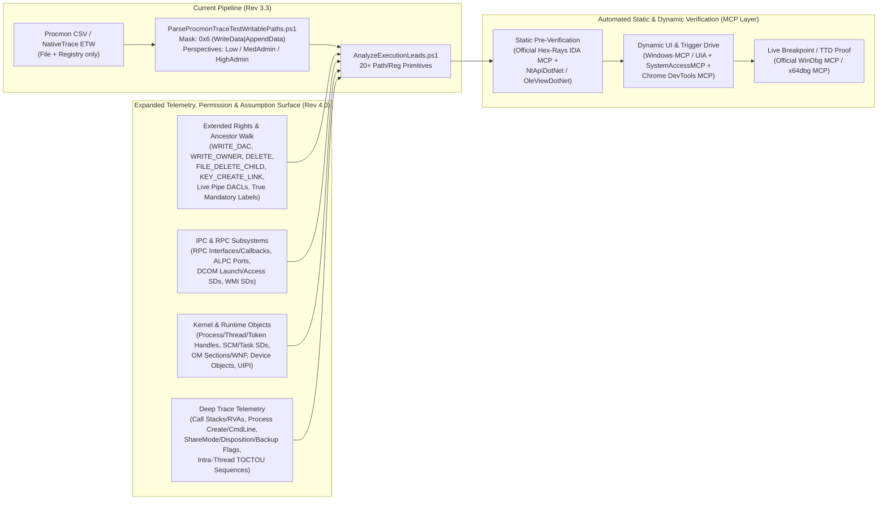
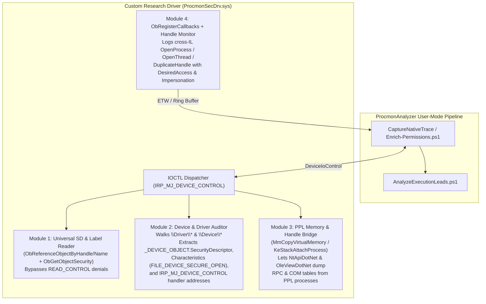

# ProcmonAnalyzer: Master Research & Architecture Roadmap (Rev 4.0)

This roadmap unifies the **Security Assumptions, Telemetry & MCP Architecture Roadmap** and the **Windows Permissions, ACLs & Subsystem Taxonomy Roadmap** into a single blueprint for evolving [ProcmonAnalyzer](file:///D:/Projects/ProcmonAnalyzer).

---

## 1. Architectural Overview & Pipeline Evolution (`Rev 3.3` → `Rev 4.0`)

Currently, `ProcmonAnalyzer` operates a 3-stage funnel ([CaptureNativeTrace.ps1](file:///D:/Projects/ProcmonAnalyzer/skills/Capture-NativeTrace/scripts/CaptureNativeTrace.ps1) → [ParseProcmonTraceTestWritablePaths.ps1](file:///D:/Projects/ProcmonAnalyzer/skills/Parse-ProcmonWriteables/scripts/ParseProcmonTraceTestWritablePaths.ps1) → [AnalyzeExecutionLeads.ps1](file:///D:/Projects/ProcmonAnalyzer/skills/Analyze-ExecutionLeads/scripts/AnalyzeExecutionLeads.ps1)) that evaluates **File System** and **Registry** paths against three token perspectives (`LowPriv`, `MediumILAdmin`, `HighILAdmin`).

---

## 2. Unverified Security Assumptions (Turning Broken Assumptions into 0-Day Leads)

Both target software developers and our current heuristic engine make implicit security assumptions about filesystem, registry, and loader behavior. Automatically detecting where those assumptions fail is one of the highest-signal ways to uncover 0-day vulnerabilities.

### 2.1 Assumption: *"Opening the leaf with `FILE_FLAG_OPEN_REPARSE_POINT` prevents path redirection"*
- **Why developers assume it's safe:** The privileged service passes `FILE_FLAG_OPEN_REPARSE_POINT` (or `FILE_OPEN_REPARSE_POINT`) when opening `C:\ProgramData\Vendor\Logs\SubDir\app.log`, assuming the kernel will not follow a junction or symlink.
- **Why that assumption fails:** `FILE_OPEN_REPARSE_POINT` **only inhibits reparse behavior on the final path component (`app.log`)**. The NT Object Manager and I/O Manager still transparently traverse junctions and Object Manager symlinks on **every intermediate parent directory** (`Vendor\`, `Logs\`, `SubDir\`).
- **How our analyzer currently misses it:**
  - In [ParseProcmonTraceTestWritablePaths.ps1](file:///D:/Projects/ProcmonAnalyzer/skills/Parse-ProcmonWriteables/scripts/ParseProcmonTraceTestWritablePaths.ps1) and [AnalyzeExecutionLeads.ps1](file:///D:/Projects/ProcmonAnalyzer/skills/Analyze-ExecutionLeads/scripts/AnalyzeExecutionLeads.ps1), if `AllOpenReparsePoint = $true` on the leaf path, the analyzer demotes the lead to the cognitive queue (`OpenReparsePoint_AlwaysSet`) as "mitigated."
  - **The Fix / New Lead Class (`Parent_Directory_Reparse_Bypass`):** Walk the ancestor chain of every privileged open. Even if `AllOpenReparsePoint = $true` on `C:\ProgramData\Vendor\Logs\SubDir\app.log`, if a non-admin can delete/rename or create `SubDir` (or `Logs`) and replace that **ancestor directory** with a junction to `\RPC Control`, the leaf's `FILE_OPEN_REPARSE_POINT` flag is completely bypassed.

### 2.2 Assumption: *"Verifying a binary's Authenticode signature before `LoadLibrary` / `CreateProcess` prevents tampering"*
- **Why developers assume it's safe:** An updater, service, or installer stages a DLL/EXE/MSI in a user-writable directory (`%TEMP%`, `C:\ProgramData\<Vendor>\Updates\`), calls `WinVerifyTrust` / `CryptQueryObject`, confirms a valid vendor signature, and then calls `CreateProcessAsUserW` or `LoadLibraryExW`.
- **Why that assumption fails:** Unless the privileged process holds an **exclusive lock (`ShareMode` without `Write`/`Delete`)** on the file handle from before `WinVerifyTrust` until *after* the image section is mapped by `NtCreateSection(SEC_IMAGE)`, a low-privileged user can place an opportunistic lock (oplock) or swap a junction/file between the verification read and the execution open.
- **How to detect it automatically (`Signature_TOCTOU_Bypass`):**
  - Detect paths in writable directories where a privileged process performs `CreateFile` + `ReadFile` (often accompanied by `CryptCATAdmin*` / catalog reads or `ShareMode: Read, Write, Delete`), followed by `CloseFile`, followed by `Load Image` or `Process Create` on the same path.

### 2.3 Assumption: *"Checking `GetFileAttributes` for `FILE_ATTRIBUTE_REPARSE_POINT` before opening is safe"*
- **Why developers assume it's safe:** Code calls `GetFileAttributesW(path)` (recorded in Procmon as `QueryOpen` or `CreateFile` with `Desired Access: Read Attributes, Options: Open Reparse Point`), checks `(attr & FILE_ATTRIBUTE_REPARSE_POINT) == 0`, and then calls `CreateFileW(path, GENERIC_WRITE, ...)` without `FILE_FLAG_OPEN_REPARSE_POINT`.
- **Why that assumption fails:** Classic check-then-use race condition (won deterministically with a directory oplock).
- **How to detect it automatically (`CheckThenUse_Reparse_TOCTOU`):** With our `AnyOpenReparsePoint` vs `AllOpenReparsePoint` split, any path where `AnyOpenReparsePoint -eq $true -and AllOpenReparsePoint -eq $false` on the **same process/thread** within a short temporal window is a prime candidate for a Check-Then-Use Reparse Race — it should be **boosted** in priority rather than treated with a caveat.

### 2.4 Assumption: *"Recursive cleanup / deletion of temp or log files doesn't write attacker bytes, so it isn't LPE"*
- **Why developers assume it's safe:** A SYSTEM maintenance service deletes old `.tmp` / `.log` / `.etl` files in a writable directory (`DeleteFileW` / `RemoveDirectoryW` / `FILE_FLAG_DELETE_ON_CLOSE`).
- **Why that assumption fails:** Arbitrary file/folder deletion as SYSTEM is a **first-class LPE primitive** on Windows via the standard **`C:\Config.Msi` rollback chain** (redirecting a folder/file delete via `QueryDirectory` oplock + junction + `\RPC Control` symlink to delete `C:\Config.Msi::$INDEX_ALLOCATION`, recreating `C:\Config.Msi` with a weak DACL, and planting an `.rbs`/`.rbf` rollback script triggered by `msiexec`).
- **How our analyzer currently misses it:**
  - `Get-OperationDirection` in [AnalyzeExecutionLeads.ps1](file:///D:/Projects/ProcmonAnalyzer/skills/Analyze-ExecutionLeads/scripts/AnalyzeExecutionLeads.ps1#L71-L106) merges `SetDispositionInformationFile` / `SetDispositionInformationEx` into generic `"Write"` (`Rule 6: Oplock_ArbitraryWrite`), and ignores `Options: Delete On Close` and `Desired Access: Delete` inside `CreateFile`.
  - **The Fix / New Lead Class (`Arbitrary_Delete_ConfigMsi_LPE`):** Explicitly parse `Desired Access: Delete`, `Options: Delete On Close`, and `SetDispositionInformationFile` / `SetDispositionInformationEx` into a dedicated `Delete` operation direction and `Arbitrary_Delete_ConfigMsi_LPE` primitive.

### 2.5 Assumption: *"Setting ACLs (`SetSecurityFile` / `icacls`) on a file inside an app directory only modifies that app file"*
- **Why developers assume it's safe:** Many services and installers self-heal permissions on startup by calling `SetNamedSecurityInfoW` or `icacls` on `C:\ProgramData\Vendor\data.db` to grant `Users:(M)` or `Everyone:(F)`.
- **Why that assumption fails:** `SetNamedSecurityInfoW` opens the target path with `WRITE_DAC` **without `FILE_FLAG_OPEN_REPARSE_POINT`**. If a low-priv user can replace a parent folder with a junction + Object Manager symlink pointing to `C:\Windows\System32\WindowsCoreDeviceInfo.dll` (or a service binary), the privileged service overwrites the DACL of a `System32` binary to grant `Users:(M)`.
- **How our analyzer currently misses it:**
  - `SetSecurityFile` and `RegSetInfoKey` (`Desired Access: Write DAC / Write Owner`) are currently folded into generic `"Write"`.
  - **The Fix / New Lead Class (`Arbitrary_DACL_Overwrite`):** Flag any privileged `SetSecurityFile` or `Desired Access: Write DAC / Write Owner` on a path with a user-writable ancestor as **Critical (`Arbitrary_DACL_Overwrite`)**.

### 2.6 Assumption: *"Impersonating the client (`Impersonating: DOMAIN\User`) makes the file/registry operation safe"*
- **Why developers assume it's safe:** The service calls `ImpersonateNamedPipeClient` or `RpcImpersonateClient` before opening the path.
- **Where that assumption fails:**
  1. **`Open For Backup` (`FILE_OPEN_FOR_BACKUP_INTENT`):** If the thread token (or primary token after revert) holds `SeBackupPrivilege` or `SeRestorePrivilege` and passes `FILE_FLAG_BACKUP_SEMANTICS` / `FILE_OPEN_FOR_BACKUP_INTENT` (visible in Procmon `Detail` as `Open For Backup`), **the kernel bypasses the DACL check completely**.
  2. **Impersonation Drop (`Identification` → `SYSTEM` Fallback):** If the client connects with `SecurityIdentification` or `Anonymous` SQOS, or `RpcImpersonateClient` fails and the service does not check the return code, the thread falls back to its primary `SYSTEM` token; or the service reads a path while impersonating and performs the subsequent action after `RevertToSelf()`.
  3. **Same-Hive `REG_LINK` Pivot During Impersonation:** While impersonating `User`, the service writes a "trusted" status flag or policy value into `HKCU\Software\Vendor\State`. Because `User` owns `HKCU`, `User` can turn `HKCU\Software\Vendor\State` into a `REG_LINK` pointing to `HKCU\Environment` (`windir`) or `HKCU\Software\Classes\ms-settings\Shell\Open\command`, turning a restricted value write into an arbitrary `HKCU` write or UAC bypass.

### 2.7 Assumption: *"Loading a DLL by absolute path (`C:\Program Files\Vendor\app.dll`) prevents DLL hijacking"*
- **Why developers assume it's safe:** The caller passes a fully qualified path in `C:\Program Files\...` to `LoadLibraryW`.
- **Why that assumption fails:**
  1. **Transitive Imports Without `LOAD_LIBRARY_SEARCH_DLL_LOAD_DIR`:** Unless `LoadLibraryExW` is called with `LOAD_LIBRARY_SEARCH_DLL_LOAD_DIR | LOAD_LIBRARY_SEARCH_SYSTEM32`, any secondary DLL imported by `app.dll` that is not in `System32` is searched in the process's **Current Working Directory (`CWD`)** and system/user **`PATH`**.
  2. **The `.local` DotLocal Trick:** Even when `app.exe` is in `C:\Program Files\Vendor\`, if `app.exe.local` exists (or the folder is writable to `MediumILAdmin` / `LowPriv`), `LoadLibrary` calls redirect first to `app.exe.local\`.
  3. **KnownDlls Exclusion:** Developers assume standard Windows DLLs (`version.dll`, `winhttp.dll`, `wtsapi32.dll`, `dbghelp.dll`, `cryptsp.dll`, `userenv.dll`, `profapi.dll`) are in `\KnownDlls`. They are **not** in `\KnownDlls`, so any privileged binary running from a writable directory or searching `PATH` will load them from the writable directory.

### 2.8 Assumption: *"Reading a registry value from a writable key is safe if the code only reads a string/number"*
- **Why developers assume it's safe:** The service reads `HKCU\Software\Vendor\Port` or a permissive `HKLM\SOFTWARE\Vendor\Config` value.
- **Why that assumption fails:**
  1. **`REG_SZ` → `REG_EXPAND_SZ` Type Confusion:** If the C/C++ service calls `RegQueryValueExW` (instead of `RegGetValueW(..., RRF_RT_REG_SZ | RRF_NOEXPAND, ...)`), or if a .NET/PowerShell service calls `RegistryKey.GetValue()`, changing a `REG_SZ` value to `REG_EXPAND_SZ` forces automatic environment variable expansion, or changing it to `REG_BINARY` / un-null-terminated `REG_SZ` triggers string over-reads in C/C++ callers.
  2. **TOCTOU Buffer Overflow on `BUFFER OVERFLOW` Size Queries:** In Procmon, C/C++ services almost always issue two consecutive `RegQueryValue` calls: the first returns `BUFFER OVERFLOW` with `Length: <N>` in `Detail`, the caller allocates `<N>` bytes on the heap, and the second `RegQueryValue` reads the data. If the key is user-writable, racing the two calls (expanding the value size between Call 1 and Call 2) leads to heap corruption in the privileged service.

---

## 3. Critical Blind Spots in Already-Collected Domains (File, Registry, Pipes & Perspectives)

Before adding a single new ETW provider, the existing parser ([ParseProcmonTraceTestWritablePaths.ps1](file:///D:/Projects/ProcmonAnalyzer/skills/Parse-ProcmonWriteables/scripts/ParseProcmonTraceTestWritablePaths.ps1)) drops high-value leads inside the File, Registry, and Named Pipe data it already ingests:

1. **Narrow Access Mask (`0x6` Only) in `Invoke-DaclEvaluation` ([ParseProcmonTraceTestWritablePaths.ps1](file:///D:/Projects/ProcmonAnalyzer/skills/Parse-ProcmonWriteables/scripts/ParseProcmonTraceTestWritablePaths.ps1#L622-L623))**:
   - Currently, the parser only tests `WriteData | AppendData` (`0x6` for FS) and `SetValue | CreateSubKey` (`0x6` for Registry).
   - **Missed Primitive — `WRITE_DAC` (`0x00040000`) & `WRITE_OWNER` (`0x00080000`)**: A principal with zero `0x6` write bits can still have `WriteDacl` or `WriteOwner` (or be the `Owner` in `$acl.Owner`, which implicitly grants `WRITE_DAC` unless restricted by an explicit `S-1-3-4` `OWNER_RIGHTS` ACE).
   - **Missed Primitive — Delete + Recreate (`DELETE` `0x00010000` on File + `FILE_ADD_FILE` `0x0002` on Parent, or `FILE_DELETE_CHILD` `0x0040` on Parent) & Full Ancestor Walk**: At [ParseProcmonTraceTestWritablePaths.ps1](file:///D:/Projects/ProcmonAnalyzer/skills/Parse-ProcmonWriteables/scripts/ParseProcmonTraceTestWritablePaths.ps1#L920-L950), if `[System.IO.File]::Exists($TargetPath)` is true, the parser checks *only* the leaf file's DACL. In Windows:
     - If a low-priv user lacks `WriteData` on `C:\ProgramData\Vendor\app.dll`, but has `DELETE` on the file (or `FILE_DELETE_CHILD` `0x40` on `C:\ProgramData\Vendor\`) plus `CreateFiles` (`0x2`) on the directory, they can delete or rename-away the root-owned file and plant a malicious replacement!
     - Furthermore, if *any* ancestor directory (`C:\ProgramData\Vendor\SubDir`) is modifiable/deletable by a low-priv user, the user can rename or junction-swap the entire ancestor folder even when the leaf file is locked down to `SYSTEM:(F)`.
   - **Missed Primitive — `KEY_CREATE_LINK` (`0x0020`) on Registry Keys**: Planting a `REG_LINK` (`Registry_Coercion`, Rule 10) requires `KEY_CREATE_LINK` (`0x0020`) + `KEY_SET_VALUE` (`0x0002`).
   - **Missed Primitive — `FILE_WRITE_ATTRIBUTES` (`0x0100`)**: Required for timestamp/attribute manipulation and involved in certain reparse/oplock state transitions.

2. **Named Pipes Hardcoded as Writable ([ParseProcmonTraceTestWritablePaths.ps1](file:///D:/Projects/ProcmonAnalyzer/skills/Parse-ProcmonWriteables/scripts/ParseProcmonTraceTestWritablePaths.ps1#L912-L925))**:
   - Every `\\.\pipe\*` path is currently stamped `WritableByLowPriv = $true` (`AclSource = "named-pipe-namespace"`).
   - This conflates two completely different primitives:
     - **Unbound Pipe (`Result = NAME NOT FOUND`)**: True server-plant candidate (governed by `\Device\NamedPipe\` granting `FILE_CREATE_PIPE_INSTANCE`).
     - **Active Pipe (`Result = SUCCESS`)**: Must query the **live pipe's DACL**:
       - **`FILE_CREATE_PIPE_INSTANCE` (`0x0004`) granted to LowPriv on an active SYSTEM pipe**: Allows a low-priv attacker to spin up a secondary server instance of a live SYSTEM pipe and hijack the next connecting client (`Pipe_Instance_Squat`).
       - **`FILE_WRITE_DATA` (`0x0002`) granted to LowPriv**: The attacker cannot squat the server, *but* can connect as a client and send arbitrary IPC/RPC payloads to the privileged pipe server (`Pipe_Client_IPC_Sink`).

3. **Path-Heuristic Integrity Labels vs. Real Mandatory Labels ([ParseProcmonTraceTestWritablePaths.ps1](file:///D:/Projects/ProcmonAnalyzer/skills/Parse-ProcmonWriteables/scripts/ParseProcmonTraceTestWritablePaths.ps1#L658-L672))**:
   - While reading *audit* ACEs (`SACL_SECURITY_INFORMATION`) requires `SeSecurityPrivilege`, reading the **Mandatory Integrity Label** via `advapi32!GetNamedSecurityInfoW` with `LABEL_SECURITY_INFORMATION` (`0x00000010`) **does NOT require any special privilege**!
   - Querying `LABEL_SECURITY_INFORMATION` directly reveals:
     - Explicit `Low` (`S-1-16-4096`), `Medium` (`S-1-16-8192`), `High` (`S-1-16-12288`), or `System` (`S-1-16-16384`) integrity labels on custom vendor folders (`C:\ProgramData\...`) that the path heuristic misses.
     - The **Mandatory Policy flags**: `SYSTEM_MANDATORY_LABEL_NO_WRITE_UP` (`0x1`), `NO_READ_UP` (`0x2`), and `NO_EXECUTE_UP` (`0x4`).

4. **Missing Perspectives (AppContainer / LPAC & Service SIDs)**:
   - Adding a 4th perspective — **`WritableByAppContainer`** (`ALL APPLICATION PACKAGES` `S-1-15-2-1`, `ALL RESTRICTED APPLICATION PACKAGES` `S-1-15-2-2`, and capability SIDs `S-1-15-3-*` + `Low` IL label check) — turns the pipeline into a **Sandbox Escape** lead generator (browser/Office/UWP escapes).
   - Tracking **`S-1-5-80-*` (`NT SERVICE\<Name>`)** grants (currently skipped in `Invoke-DaclEvaluation`) enables **multi-hop escalation leads** (e.g., `NETWORK SERVICE` or a compromised third-party service can write to a binary/key consumed by `SYSTEM`).

---

## 4. Deep-Dive: New Windows Subsystems & Permission Structures to Analyze

### 4.A RPC (Remote Procedure Call) & ALPC (Advanced Local Procedure Call)

Privileged file/registry operations in Procmon traces (`svchost.exe`, `spoolsv.exe`, `lsass.exe`, third-party services) are frequently triggered by an incoming RPC or ALPC call. Analyzing RPC/ALPC permissions tells you **whether a low-priv user can trigger that privileged operation on demand and control its path arguments**.

| Permission Layer | Where It Lives | Access Rights / Flags to Analyze | Research Leads Surfaced |
|---|---|---|---|
| **ALPC Port Object DACL** | Object Manager `\RPC Control\*`, `\Sessions\*\BaseNamedObjects\*` (`ALPC Port` type) | `PORT_CONNECT` (`0x0001`), `WRITE_DAC` (`0x40000`), `WRITE_OWNER` (`0x80000`) | Identifies which ALPC endpoints a LowPriv or AppContainer token can connect to, or overwrite the DACL of. |
| **RPC Endpoint / Server SD** | Registered at runtime via `RpcServerUseProtseqEpEx(..., SecurityDescriptor)` | Generic Read/Write/Execute on endpoint transport (`ncalrpc`, `ncacn_np`, `ncacn_ip_tcp`) | Finds network-exposed (`ncacn_ip_tcp` / `ncacn_np`) RPC endpoints reachable for **RCE / Lateral Movement**. |
| **RPC Interface SD & Flags** | In-memory `RPC_SERVER_INTERFACE` (`rpcrt4.dll` runtime table) registered via `RpcServerRegisterIf2/Ex` | `SecurityDescriptor` blob + Interface Flags: `RPC_IF_ALLOW_CALLBACKS_WITH_NO_AUTH` (`0x0010`), `RPC_IF_ALLOW_LOCAL_ONLY` (`0x0020`), `RPC_IF_SEC_NO_CACHE` (`0x0040`) | Surfaces SYSTEM RPC interfaces with **NULL Interface SD** or `RPC_IF_ALLOW_CALLBACKS_WITH_NO_AUTH` (allowing unauthenticated/anonymous calls). |
| **RPC Security Callback (`RPC_IF_CALLBACK_FN`)** | Function pointer inside service DLL/EXE | Static/dynamic inspection of callback: Does it check caller SID? Does it call `RpcImpersonateClient`? | **High-value bug class**: (1) Callback missing entirely; (2) Handler executes file/reg ops as **Pure SYSTEM** without calling `RpcImpersonateClient`; (3) Handler calls `RpcImpersonateClient` *without checking the return code* (can be forced to fail via `Anonymous` token level, falling back to SYSTEM!). |

**How to correlate with Procmon traces:**
- Add `Microsoft-Windows-RPC` (`{6ad52b32-d609-4be9-ae07-ce8dae937e39}`) to [CaptureNativeTrace.ps1](file:///D:/Projects/ProcmonAnalyzer/skills/Capture-NativeTrace/scripts/CaptureNativeTrace.ps1).
- When a privileged process performs a file/registry operation at timestamp $T$ on thread `TID`, look up the active `RpcServerCall` event on `(PID, TID)` immediately preceding $T$ to extract the exact **`InterfaceUuid` + `OpNum`** that caused the I/O!

---

### 4.B DCOM / COM (Component Object Model)

COM/DCOM uses a multi-layered permission model combining registry key DACLs, serialized `REG_BINARY` security descriptors, and in-process runtime descriptors.

| Permission Structure | Location | Specific Bits / Values to Parse | Research Leads Surfaced |
|---|---|---|---|
| **AppID LaunchPermission** | `HKLM\SOFTWARE\Classes\AppID\{GUID}` → `LaunchPermission` (`REG_BINARY` SD) | `COM_RIGHTS_EXECUTE` (`0x1`), `EXECUTE_LOCAL` (`0x2`), `EXECUTE_REMOTE` (`0x4`), `ACTIVATE_LOCAL` (`0x8`), `ACTIVATE_REMOTE` (`0x10`) | Identifies privileged (`RunAs = Interactive User` or `LocalService` = SYSTEM) DCOM classes that a LowPriv or Service user can instantiate (Cross-Session / Potato / Lateral Movement leads). |
| **AppID AccessPermission** | `HKLM\SOFTWARE\Classes\AppID\{GUID}` → `AccessPermission` (`REG_BINARY` SD) | `COM_RIGHTS_EXECUTE` (`0x1`), `EXECUTE_LOCAL` (`0x2`), `EXECUTE_REMOTE` (`0x4`) | Identifies running COM servers whose methods can be called by a lower-IL process. |
| **Machine-Wide Restrictions** | `HKLM\SOFTWARE\Microsoft\Ole` → `MachineLaunchRestriction`, `MachineAccessRestriction`, `DefaultLaunchPermission`, `DefaultAccessPermission` | Same `COM_RIGHTS_*` masks (Machine restrictions act as a hard ceiling) | Prevents false positives where an AppID grants access that `MachineLaunchRestriction` globally blocks. |
| **Runtime Process COM Security** | `CoInitializeSecurity` parameters in live process (`combase!gSecDesc`, `gAuthnLevel`, `gCapabilities`) | `RPC_C_AUTHN_LEVEL_NONE`, `EOAC_DYNAMIC_CLOAKING`, `EOAC_STATIC_CLOAKING`, or `pSecDesc == NULL` | Processes calling `CoInitializeSecurity(NULL, ...)` allow any local user to invoke methods on their registered COM objects; `EOAC_DYNAMIC_CLOAKING` propagates impersonation tokens across outbound COM calls. |
| **UAC Auto-Elevation Metadata** | `HKLM\SOFTWARE\Classes\CLSID\{GUID}\Elevation` (`Enabled = 1`) + `VirtualServerObjects` | Cross-referenced with `InprocServer32` / `LocalServer32` / `TypeLib` DACLs | Discovers unhardened UAC auto-elevated COM classes (beyond `CMSTPLUA`) for `UAC_Bypass` leads. |
| **CLSID / ProgID / TypeLib / TreatAs DACLs & Dangling Targets** | `HKLM` & `HKCR` (`CLSID`, `Interface`, `TypeLib`, `AppID`) | Key DACLs (`SetValue`, `CreateSubKey`, `WriteDacl`) + missing `InprocServer32`/`LocalServer32` paths (`NAME NOT FOUND`) | Surfaces **HKLM COM Hijacks** (affecting all users/SYSTEM without needing `HKCU` impersonation) and **TypeLib/ProxyStub hijacks**. |

---

### 4.C WMI (Windows Management Instrumentation)

When `wmiprvse.exe` shows up in Procmon touching a writable path as `SYSTEM`, Procmon alone does not tell you *which WMI namespace, class, or provider* is responsible, nor *who is allowed to invoke it*.

| Permission Structure | Location | Specific Bits / Properties | Research Leads Surfaced |
|---|---|---|---|
| **WMI Namespace Security Descriptor** | CIM Repository (`__SystemSecurity::GetSecurityDescriptor` per namespace: `ROOT\CIMV2`, `ROOT\Subscription`, `ROOT\<Vendor>`) | `WBEM_ENABLE` (`0x1`), `WBEM_METHOD_EXECUTE` (`0x2`), `WBEM_FULL_WRITE_REP` (`0x4`), `WBEM_PARTIAL_WRITE_REP` (`0x8`), `WBEM_WRITE_PROVIDER` (`0x10`), `WBEM_REMOTE_ACCESS` (`0x20`), `WRITE_DAC` (`0x40000`) | Finds vendor-created WMI namespaces (`ROOT\Dell`, `ROOT\HP`, `ROOT\Lenovo`, etc.) that grant `WBEM_METHOD_EXECUTE` or `WBEM_PARTIAL_WRITE_REP` to `Authenticated Users`. |
| **`__Win32Provider` HostingModel & SD** | WMI `__Win32Provider` instances in each namespace | `HostingModel`: `LocalSystemHost` / `LocalSystemHostOrSelfHost` vs `NetworkServiceHost` vs `Decoupled:Com`; `SecurityDescriptor` SDDL on the provider | **`LocalSystemHost` Provider**: Runs as **Pure SYSTEM** without impersonating by default! If the provider doesn't call `CoImpersonateClient()`, any LowPriv user with `WBEM_METHOD_EXECUTE` gets SYSTEM execution. **`Decoupled:Com` Provider**: If the provider SD allows LowPriv, an attacker can register a rogue decoupled provider via `IWbemDecoupledRegistrar` to hijack WMI queries from SYSTEM processes! |
| **WMI Method Qualifiers** | Class MOF / CIM definition (`Get-CimClass`) | `Implemented`, `Privileges`, `Static`, parameter types (`string` file paths) | Identifies callable WMI methods that accept file paths, command lines, or registry paths. |

---

### 4.D Process, Thread & Token Security Descriptors (Handle & Memory Surface)

Procmon traces `Process Start` and `Process Create`, but ignores the **Kernel Object Security Descriptors** of running processes, threads, tokens, and their open handle tables.

| Target Object | Access Mask Bits / Properties to Audit | Research Leads Surfaced |
|---|---|---|
| **Process Object (`_EPROCESS`)** | `PROCESS_CREATE_PROCESS` (`0x0080`), `PROCESS_CREATE_THREAD` (`0x0002`), `PROCESS_VM_WRITE` (`0x0020`), `PROCESS_VM_OPERATION` (`0x0008`), `PROCESS_DUP_HANDLE` (`0x0040`), `PROCESS_SET_INFORMATION` (`0x0200`), `WRITE_DAC` (`0x40000`), `WRITE_OWNER` (`0x80000`) | **Direct Process Takeover**: Third-party services that call `SetSecurityInfo` with a permissive/NULL DACL on their own process handle allow a LowPriv user to inject a thread, spoof parent PID (`PROCESS_CREATE_PROCESS`), or duplicate its SYSTEM token handle. |
| **Process Mandatory Policy (SACL)** | `SYSTEM_MANDATORY_LABEL_NO_READ_UP` (`0x2`), `NO_EXECUTE_UP` (`0x4`), `NO_WRITE_UP` (`0x1`) | If a High-IL process lacks `NO_WRITE_UP` on its process SACL and has a permissive DACL, a Medium-IL process can open it for write despite MIC! |
| **Thread Object (`_ETHREAD`)** | `THREAD_DIRECT_IMPERSONATION` (`0x0200`), `THREAD_SET_CONTEXT` (`0x0010`), `THREAD_IMPERSONATE` (`0x0100`), `WRITE_DAC` (`0x40000`) | **`NtImpersonateThread` Token Theft**: If a privileged thread grants `THREAD_DIRECT_IMPERSONATION` to LowPriv, a low-priv thread can directly copy its SYSTEM/High token! |
| **Token Object (`_TOKEN`)** | `TOKEN_DUPLICATE` (`0x0002`), `TOKEN_IMPERSONATE` (`0x0004`), `TOKEN_ASSIGN_PRIMARY` (`0x0001`), `TOKEN_ADJUST_PRIVILEGES` (`0x0020`), `TOKEN_ADJUST_DEFAULT` (`0x0080`), `TokenDefaultDacl` | **Permissive `TokenDefaultDacl`**: Every object (pipe, section, event, file without inheritance) created by that token inherits `TokenDefaultDacl`. If a service's `TokenDefaultDacl` grants `GENERIC_ALL` to `Everyone`, every unnamed/named kernel object it creates is hijackable. |
| **Leaked / Inherited Handles (`SystemExtendedHandleInformation`)** | Enumerate all handles in Medium/Low-IL processes where the referenced kernel object belongs to a High/SYSTEM process or privileged File/Reg/Section/Token with Write/AllAccess `GrantedAccess` | **Inherited Handle LPE**: When a SYSTEM service or elevated installer spawns a user-session helper (e.g., OEM tray app, updater UI, browser helper) without `PROC_THREAD_ATTRIBUTE_HANDLE_LIST` and leaves `bInheritHandles = TRUE`, the Medium-IL child inherits raw `PROCESS_ALL_ACCESS`, `TOKEN_ALL_ACCESS`, or `KEY_WRITE` handles! |

---

### 4.E Services (SCM), Scheduled Tasks & Trigger Surfaces

In [AnalyzeExecutionLeads.ps1](file:///D:/Projects/ProcmonAnalyzer/skills/Analyze-ExecutionLeads/scripts/AnalyzeExecutionLeads.ps1), many `Binary_Plant_HighPriv`, `Config_Poison`, and `Service_BinaryPath` leads require **triggering or restarting** a privileged consumer.

| Permission Structure | Location | Specific Bits / Triggers | Research Leads Surfaced |
|---|---|---|---|
| **Service Security Descriptor** | SCM Database (`QueryServiceObjectSecurity` / `sc.exe sdshow <svc>`) | `SERVICE_CHANGE_CONFIG` (`0x0002`), `SERVICE_START` (`0x0010`), `SERVICE_STOP` (`0x0020`), `SERVICE_USER_DEFINED_CONTROL` (`0x0100`), `WRITE_DAC` (`0x40000`), `WRITE_OWNER` (`0x80000`) | 1. **Direct LPE**: `SERVICE_CHANGE_CONFIG` or `WRITE_DAC` granted to LowPriv. 2. **Lead Multiplier**: If a service has a DLL/Config plant lead in Procmon AND grants `SERVICE_START \| SERVICE_STOP` to `Authenticated Users` / `INTERACTIVE`, the lead upgrades from "requires reboot" to **instant on-demand LPE**! 3. **Custom Control Code Attack Surface**: `SERVICE_USER_DEFINED_CONTROL` (`0x0100`) lets LowPriv send control codes `128..255` via `ControlService` to trigger privileged file/reg actions inside the service. |
| **Service Trigger Info** | `HKLM\SYSTEM\CurrentControlSet\Services\<svc>\TriggerInfo\*` (`sc.exe qtriggerinfo`) | ETW Provider Trigger (`Type 5`), Named Pipe/RPC Trigger (`Type 2`), WNF State Trigger (`Type 8`), Device Interface Arrival (`Type 1`) | Even when `SERVICE_START` is denied to LowPriv, a LowPriv user can **start a `Manual` SYSTEM service on demand** by writing an ETW event to its trigger GUID or updating its WNF state name! |
| **ETW Provider Security Descriptors** | `HKLM\SYSTEM\CurrentControlSet\Control\WMI\Security\<GUID>` (`REG_BINARY` SD) | `WMIGUID_NOTIFICATION` (`0x0004`), `TRACELOG_REGISTER_GUIDS` (`0x0008`), `TRACELOG_ACCESS_REALTIME` (`0x0400`) | Confirms whether a LowPriv user is permitted to fire an ETW Service Trigger (`TRACELOG_REGISTER_GUIDS`) or eavesdrop on sensitive real-time ETW telemetry (`TRACELOG_ACCESS_REALTIME`). |
| **Task Scheduler `TaskCache` SD** | `HKLM\SOFTWARE\Microsoft\Windows NT\CurrentVersion\Schedule\TaskCache\Tree\<TaskPath>\SD` (`REG_BINARY`) | `TASK_EXECUTE` / `FILE_EXECUTE` (`0x0020`), `FILE_WRITE_DATA` (`0x0002`), `WRITE_DAC` (`0x40000`) | Rule 4 in `AnalyzeExecutionLeads.ps1` only checks `C:\Windows\System32\Tasks\*` file ACLs. Checking the `TaskCache\Tree\...\SD` registry blob reveals **which SYSTEM scheduled tasks a LowPriv user can manually trigger on demand (`schtasks /run`)**, or pass command-line arguments (`$(Arg0)`) to via `IRegisteredTask::RunEx`! |

---

### 4.F Object Manager Namespace, Shared Memory (`Section`), WNF & Kernel Drivers (`\Device\*`)

1. **Object Manager Directories & Symbolic Links (`\`, `\BaseNamedObjects`, `\RPC Control`, `\GLOBAL??`, `\Sessions\*\DosDevices`)**:
   - **Access Bits**: `DIRECTORY_CREATE_OBJECT` (`0x0004`), `DIRECTORY_CREATE_SUBDIRECTORY` (`0x0008`).
   - Surfaces non-standard Object Manager directories created by third-party drivers/services where LowPriv can plant `SymbolicLink` objects.
2. **Named Shared Memory (`Section` Objects in `\BaseNamedObjects\Global\*` and `\Sessions\*\BaseNamedObjects\*`)**:
   - **Access Bits**: `SECTION_MAP_WRITE` (`0x0002`), `SECTION_MAP_READ` (`0x0004`), `SECTION_EXTEND_SIZE` (`0x0010`).
   - When a SYSTEM process and a user process communicate via `CreateFileMapping` / `MapViewOfFile`, a Section DACL granting `SECTION_MAP_WRITE` to LowPriv allows shared-memory corruption (pointer/offset tampering, IPC command injection) inside the privileged process.
3. **WNF (Windows Notification Facility) State Names**:
   - **Location**: `HKLM\SYSTEM\CurrentControlSet\Control\Notifications` (`SecurityDescriptor` per 64-bit State Name).
   - **Access Bits**: `WNF_STATE_READ` (`0x1`), `WNF_STATE_WRITE` (`0x2`).
   - Allows LowPriv processes to broadcast arbitrary state buffers (`NtUpdateWnfStateData`) to SYSTEM subscribers.
4. **Kernel Driver Device Objects (`\Device\*` and `\GLOBAL??\*`)**:
   - **Current Gap**: [ParseProcmonTraceTestWritablePaths.ps1](file:///D:/Projects/ProcmonAnalyzer/skills/Parse-ProcmonWriteables/scripts/ParseProcmonTraceTestWritablePaths.ps1#L180-L235) strips or skips `\Device\*` paths unless they are `\Device\HarddiskVolume*` or `\Device\NamedPipe*`.
   - **Access Bits & Flags**:
     - Device DACL granting `FILE_READ_DATA` (`0x1`), `FILE_WRITE_DATA` (`0x2`), or even `SYNCHRONIZE` / `0` access (because IOCTLs encoded with `FILE_ANY_ACCESS` (`0`) can be sent on *any* valid handle returned by `CreateFile`!).
     - **`FILE_DEVICE_SECURE_OPEN` (`0x00000100`) missing in `_DEVICE_OBJECT->Characteristics`**: If a driver omits `FILE_DEVICE_SECURE_OPEN`, opening `\Device\VulnDriver\foo` **bypasses the `\Device\VulnDriver` DACL check entirely** in the I/O Manager!

---

### 4.G Window Stations, Desktops & UIPI (`Win32k` / GUI Surface)

- **Window Station (`WinSta0`) & Desktop (`Default`, `Winlogon`) DACLs**:
  - `DESKTOP_HOOKCONTROL` (`0x0008`), `DESKTOP_JOURNALPLAYBACK` (`0x0004`), `DESKTOP_WRITEOBJECTS` (`0x0080`).
- **UIPI Exceptions (`ChangeWindowMessageFilterEx` & `uiAccess="true"`)**:
  - Enumerating top-level and message-only `HWND`s in the interactive session (`WinSta0\Default`) owned by **High-IL or SYSTEM processes** (e.g., OEM helpers, accessibility tools, auto-elevated `uiAccess` binaries, or services with `SERVICE_INTERACTIVE_PROCESS`).
  - Any High-IL window that calls `ChangeWindowMessageFilterEx(hwnd, msg, MSGFLT_ALLOW, ...)` exposes an IPC sink (`WM_COPYDATA`, `WM_DROPFILES`, `WM_USER+X`) to Medium-IL callers (`Shatter` attack surface).

---

## 5. Missing Data in Trace Collections (Procmon & ETW Telemetry Upgrades)

Right now, [ParseProcmonTraceTestWritablePaths.ps1](file:///D:/Projects/ProcmonAnalyzer/skills/Parse-ProcmonWriteables/scripts/ParseProcmonTraceTestWritablePaths.ps1) only ingests 8 columns (`Time of Day`, `Process Name`, `PID`, `Operation`, `Path`, `Result`, `Detail`, `Integrity` / `Impersonating`) and collapses all events per path into a single representative event. Here is what we should extract next:

| Missing Data Source / Field | Where It Lives | Why It Unlocks More Leads |
|---|---|---|
| **Call Stacks (`Stack` / Module + RVA)** | Procmon `.PML` / `.XML` export & ETW `StackWalk` | Tells you the exact **DLL + function offset (`myservice.dll + 0x14A20`)** that made the vulnerable `NtCreateFile`/`NtOpenKeyEx` call. Eliminates hours of blind string-hunting in `svchost.exe` and feeds directly into the **Official IDA MCP**. |
| **`Process Create` & `Command Line` & `Parent PID`** | Procmon `Process Create` rows & `Command Line` column | Currently dropped because `Process Create` rows don't match `$isTargetOp`. Without `Command Line`, `svchost.exe` (which hosts 80+ services), `dllhost.exe` (`/Processid:{CLSID}`), `taskhostw.exe`, and `rundll32.exe` are opaque black boxes. |
| **Granular `Detail` Parsing (`Desired Access`, `Disposition`, `ShareMode`, `Options`)** | Already in the CSV `Detail` column (currently unparsed!) | <ul><li>**`Desired Access`:** Separates `Delete`, `Write DAC`, `Write Owner` from benign `Read Attributes` / `Synchronize`.</li><li>**`Disposition`:** `Create` / `Supersede` / `OverwriteIf` vs `Open` (tells you if the service will create a missing file or only open an existing one).</li><li>**`ShareMode`:** Tells you if an oplock or concurrent write race is allowed while the privileged handle is open.</li><li>**`Options`:** `Delete On Close`, `Open For Backup`, `Directory File` vs `Non-Directory File` (determines whether a pure NTFS junction works or if `\RPC Control` file symlink is required).</li></ul> |
| **Registry Value Type & Data Preview (`Data:` Path Extraction)** | Already in CSV `Detail` for `RegQueryValue` / `RegSetValue` | Extracting `Type: REG_SZ, Length: ..., Data: C:\...` from `Detail` lets the analyzer see when a *non-writable* `HKLM` registry key's `Data:` points to a *writable* `C:\ProgramData\...` file, missing folder, command line, or CLSID! |
| **Thread ID (`TID`) & Intra-Thread Event Sequences** | Procmon `TID` column | Enables automatic detection of **TOCTOU chains** on the exact same thread: e.g., `QueryOpen (Open Reparse Point)` → `CreateFile (no Open Reparse Point)`, `CreateFile(Read)` → `CloseFile` → `Load Image`, or `RegQueryValue (BUFFER OVERFLOW)` → `RegQueryValue (SUCCESS)`. |
| **Session ID (`Session`) & Virtualization (`Virtualized`)** | Procmon `Session` / `Virtualized` columns | Detects **Cross-Session (`Session 0` ↔ `Session 1+`)** interactions (e.g., a `Session 0` SYSTEM service touching a path in an interactive user's session, or a `High-IL` process running in `Session 1`). |

---

## 6. Next-Gen MCP Ecosystem (Reversing, Debugging, and Usermode UI)

Upgrading the agent's MCP toolbelt transforms `ProcmonAnalyzer` from a **trace triage tool** into an **autonomous vulnerability research & static+dynamic verification pipeline**.

### 6.1 Static Reversing: Official Hex-Rays IDA MCP (`HexRaysSA/ida-mcp`) & `mrexodia/ida-pro-mcp`
When `AnalyzeExecutionLeads.ps1` flags a lead, the research agent currently has to guess what the binary *actually does* with the file/registry handle.

- **Official Hex-Rays IDA MCP (`HexRaysSA/ida-mcp`):**
  - Built officially by Hex-Rays on top of **`idalib` (IDA Pro 9.0+)** and **IDA Nexus** (installable via `uvx ida-hcli mcp install`).
  - **Headless & Multi-Agent Ready:** Because it uses `idalib`, `ProcmonAnalyzer` can spawn headless IDA analysis workers in the background (no GUI required) for the top $N$ leads in `high_confidence_leads.json`.
  - **Automated Static Verification Workflow (`Verify-LeadStatically`):**
    1. Resolve the target binary (e.g., for `svchost.exe`, query `HKLM\SYSTEM\CurrentControlSet\Services\<Svc>\Parameters\ServiceDll`, or read the module from the Procmon call stack).
    2. Open the binary in `ida-mcp` with Microsoft Symbol Server PDB auto-loading enabled.
    3. Find XREFs to the file/registry string (or jump directly to the Procmon call stack RVA) and decompile the function + callers.
    4. **Answer 4 Questions Statically Before Touching the VM:**
       - *What flags are passed to `CreateFileW` / `NtCreateFile` / `RegOpenKeyExW`?* (Is `FILE_FLAG_OPEN_REPARSE_POINT` or `REG_OPTION_OPEN_LINK` missing in code?)
       - *Does the code check the return value of `RpcImpersonateClient` / `ImpersonateNamedPipeClient`?*
       - *What sink receives the handle or buffer?* (`LoadLibrary`, `CreateProcessAsUser`, `XmlReader`, `JsonSerializer`, `WriteFile`, `SetSecurityInfo`)
       - *How is the code path triggered?* (Walk XREFs upward to find the triggering RPC `OpNum`, COM method, named pipe command, WNF state name, or service control code.)
- **Community `mrexodia/ida-pro-mcp`:**
  - Ideal when a human researcher has IDA Pro open alongside the agent: supports live write-back annotations (`rename`, `set_comments`, type declarations) so the agent documents the vulnerability call chain directly inside the researcher's open `.i64` database.

### 6.2 Usermode Windows UI Interaction MCPs (Pairing with `SystemAccessMCP`)
In [skills/Research-Lead/SKILL.md](file:///D:/Projects/ProcmonAnalyzer/skills/Research-Lead/SKILL.md), `SystemAccessMCP` (`HostHyperV` + `GuestDesktop`) is the primary GUI driver. While `HostHyperV` is essential for the **Secure Desktop** (`consent.exe`, Winlogon, UAC prompts), driving complex **usermode desktop applications** (clicking through multi-tab vendor EDR/VPN settings UIs, triggering "Export Diagnostics" dialogs, or interacting with MMC/WinUI/WPF controls) via raw pixel screenshots + mouse coordinates is slow and brittle.

- **Recommended Three-Tier UI Architecture:**
  1. **Tier 1 — In-Guest Accessibility / UI Automation (UIA) MCP (Default for Usermode Apps):**
     - **[`CursorTouch/Windows-MCP`](https://github.com/CursorTouch/Windows-MCP)** (`uvx windows-mcp`) or **[`locomorange/uiautomation-mcp`](https://github.com/locomorange/uiautomation-mcp)** (.NET Native AOT implementation of Microsoft UI Automation).
     - **Why:** Exposes the exact Windows UI Automation control tree (`AutomationId`, `Name`, `ControlType`, `InvokePattern`, `ValuePattern`, `ExpandCollapsePattern`) for fast, deterministic UI driving without coordinate guessing.
     - **Research Unlock — Automated "UI Surface Fuzzing" During Trace Capture:** An agent can attach `Windows-MCP` / `uiautomation-mcp` to a target vendor application, systematically enumerate and invoke every button/menu item ("Check for Updates", "Repair Service", "Collect Logs", "Import Profile") while `Capture-NativeTrace` or Procmon runs in the background, and diff the trace against an idle baseline.
  2. **Tier 2 — `SystemAccessMCP` (`HostHyperV` Profile) for Secure Desktop & Session 0 / Winlogon:**
     - Dedicated to crossing the session/desktop boundary (`consent.exe` UAC prompts, Lock Screen, Credential Providers, Winlogon accessibility triggers, and VM snapshot orchestration).
  3. **Tier 3 — Chrome DevTools / Playwright MCP (`chrome-devtools-plugin`) for Electron & WebView2 Targets:**
     - Modern Windows apps (Teams, New Outlook, Widgets, OEM control centers, VPN clients) are frequently **Electron** or **WebView2** apps talking to a privileged native broker/service.
     - Attaching via `--remote-debugging-port` (`WEBVIEW2_ADDITIONAL_BROWSER_ARGUMENTS="--remote-debugging-port=9222"`) with the **Chrome DevTools MCP** lets the agent inspect `window.chrome.webview.postMessage` / Electron `ipcRenderer` bridges and test `Config_Poison` / `Electron_AsarTamper` leads directly in the live DOM.

### 6.3 Dynamic Debugging & Time-Travel Debugging (TTD): Official WinDbg MCP & `x64dbg` MCP
- **Official Microsoft WinDbg MCP (built into WinDbg `1.2610+`) / `glslang/windbg-mcp`:**
  - Connects the agent directly to user-mode, kernel-mode, or **Time Travel Debugging (TTD)** sessions.
  - Recording a 5-second TTD trace (`ttd.exe -attach <PID>`) of the target service while triggering the operation lets the agent query every call to `ntdll!NtCreateFile` / `ntdll!NtOpenKeyEx` backward and forward in time, inspect `OBJECT_ATTRIBUTES.Attributes` (`OBJ_DONT_REPARSE` / `0x1000`), and verify the thread token (`!token`) at the exact instruction pointer.
- **`x64dbg-mcp-server` (`duty1g/x64dbg-mcp-server`) / `x64dbg-automate-mcp`:**
  - Lightweight alternative for stripped 3rd-party user-mode binaries when rapid conditional breakpoint scripting and memory inspection are needed inside the guest VM.

---

## 7. Tooling & Implementation Matrix (3 Tiers)

To integrate all of the above into `ProcmonAnalyzer`, capabilities split cleanly into **three implementation tiers**:

### Tier 1: Zero-Install Native Windows (PowerShell / C# P/Invoke + Built-in ETW)
*Can be added directly to `CaptureNativeTrace.ps1`, `ParseEtwTrace.ps1`, `ParseProcmonTraceTestWritablePaths.ps1`, and `AnalyzeExecutionLeads.ps1` with zero external dependencies.*

| Capability | Native API / Mechanism |
|---|---|
| **Extended File/Reg ACL Masks (`WRITE_DAC`, `WRITE_OWNER`, `DELETE`, `FILE_DELETE_CHILD`, `KEY_CREATE_LINK`, Owner SID, `S-1-15-2-*`, `S-1-5-80-*`) & Ancestor Walk** | Pure `.NET` `CommonSecurityDescriptor` + `GetOwner([SecurityIdentifier])` inside `Invoke-DaclEvaluation` + parent directory loop |
| **True Mandatory Integrity Label & Policy (`NO_WRITE_UP`, `NO_READ_UP`, `NO_EXECUTE_UP`)** | P/Invoke `advapi32!GetNamedSecurityInfoW` with `LABEL_SECURITY_INFORMATION` (`0x10`) — **works as standard unprivileged user!** |
| **Live Named Pipe DACLs (`\\.\pipe\*`)** | `[System.IO.Directory]::GetFiles("\\.\pipe\")` + `GetNamedSecurityInfoW` / `Get-Acl` on active pipes (`FILE_CREATE_PIPE_INSTANCE` vs `FILE_WRITE_DATA`) |
| **Granular `Detail` & `Process Create` / `TID` Sequence Parsing** | Regex/token extraction on Procmon `Detail` (`Desired Access`, `Disposition`, `ShareMode`, `Options`, Registry `Data:`) + per-`(PID, TID)` sliding window |
| **Service SDs, Triggers & TaskCache SDs** | `advapi32!QueryServiceObjectSecurity`, `QueryServiceConfig2W(SERVICE_CONFIG_TRIGGER_INFO)`, and `.NET` `RawSecurityDescriptor` on `HKLM\...\TaskCache\Tree\*\SD` |
| **DCOM/COM Registry Binary SDs (`LaunchPermission`, `AccessPermission`, `Elevation`)** | `.NET` `New-Object System.Security.AccessControl.RawSecurityDescriptor($bytes, 0)` evaluated against `COM_RIGHTS_*` masks |
| **WMI Namespace SDs & `HostingModel`** | Built-in `Invoke-CimMethod -ClassName __SystemSecurity -MethodName GetSecurityDescriptor` + `Get-CimInstance __Win32Provider` |
| **System-Wide Leaked Handle Scanner** | P/Invoke `ntdll!NtQuerySystemInformation(SystemExtendedHandleInformation = 64)` — returns all handles, PIDs, Object Type indices, and `GrantedAccess` masks from user mode! |
| **RPC, COM, WMI & Kernel Object Telemetry** | Add built-in ETW providers to `CaptureNativeTrace.ps1`: • `Microsoft-Windows-RPC` (`{6ad52b32-d609-4be9-ae07-ce8dae937e39}`) • `Microsoft-Windows-COMRuntime` (`{bf406804-6afa-46e7-8a48-6c357e1d6d61}`) • `Microsoft-Windows-WMI-Activity` (`{1418ef04-b0b4-4623-bf7e-d74ab47bbbd3}`) • `Microsoft-Windows-Kernel-Object` (`{89497f50-effe-4440-8cf2-ce6b1cdcaca7}`) |

---

### Tier 2: External User-Mode Security & Reversing Tooling (Install in Analysis Environment)
*Needed when static binary NDR/IDL parsing, decompilation, UI automation, or deep runtime COM/RPC introspection is required.*

| Tool / Library / MCP | Why It Is Needed (What Native OS Tools Can't Do) | How `ProcmonAnalyzer` Should Use It |
|---|---|---|
| **Official Hex-Rays IDA MCP (`HexRaysSA/ida-mcp`) & `mrexodia/ida-pro-mcp`** | Decompiles target binaries/DLLs headlessly (`idalib`) or interactively to verify `CreateFile`/`RegOpenKey` flags, impersonation checks, and data sinks statically. | Power the new `Verify-LeadStatically` skill between `Analyze-ExecutionLeads` and `Research-Lead`. |
| **NtObjectManager / NtApiDotNet** *(PowerShell Gallery / James Forshaw)* | Parses compiled `MIDL_SERVER_INFO` / NDR bytecode out of PE files (`Get-RpcServer`) to recover RPC procedure signatures (e.g., which `OpNum` takes a `wchar_t*` path!), extracts RPC `SecurityCallback` RVAs, and enumerates ALPC ports (`Get-NtAlpcPort`), Object Manager directories (`Get-NtDirectory`), and WNF descriptors. | Run a pre-analysis enrichment pass that dumps `rpc_endpoints.json` and `om_namespace_acls.json` for `AnalyzeExecutionLeads.ps1` to cross-reference by `ProcessName` / `PID`. |
| **OleViewDotNet** *(James Forshaw)* | Builds a unified COM/DCOM database resolving ProxyStubs, TypeLibs, `Elevation` flags, and parses live `CoInitializeSecurity` (`gSecDesc`) out of running non-PPL processes. | Export the host's COM database to JSON and join on CLSIDs observed in `HKCR\CLSID\{...}` registry events or `Microsoft-Windows-COMRuntime` ETW events. |
| **Windows UIA MCP (`CursorTouch/Windows-MCP` / `locomorange/uiautomation-mcp`) + `SystemAccessMCP`** | Fast, deterministic UI Automation tree traversal for usermode apps + `HostHyperV` for Secure Desktop (`consent.exe` / Winlogon). | Drive active UI surface fuzzing during trace capture (`Capture-AppSurfaceTrace`) and automate PoC reproduction in `Research-Lead`. |
| **Official WinDbg MCP (TTD) & `x64dbg-mcp-server`** | Time-Travel Debugging (`.run` traces) and live conditional breakpoint verification of race conditions and token states. | Prove `EXPLOITABLE` verdicts in `Research-Lead` with exact instruction/token evidence. |
| **RpcView** *(Optional CLI/GUI)* | Decompiles live registered RPC interfaces directly from `rpcrt4.dll` private heap structures in running processes (catches dynamically registered interfaces that static PE scanning misses). | Point at high-interest service PIDs identified in `high_confidence_leads.json`. |

---

### Tier 3: Custom Kernel Driver (`ProcmonSecDrv.sys`) — When & Why to Build One

Even an elevated Administrator with `SeDebugPrivilege` hits **three hard OS kernel walls** in modern Windows 10/11:

> [!IMPORTANT]
> **Why User-Mode Tooling Hits a Wall:**
> 1. **PPL (Protected Process Light) Memory Stripping**: User-mode tools (`NtApiDotNet`, `OleViewDotNet`, `RpcView`) cannot open `PROCESS_VM_READ` handles to PPL processes (`services.exe`, `lsass.exe`, `csrss.exe`, `smss.exe`, `MsMpEng.exe`, `WerFaultSecure.exe`). Thus, you cannot read their in-memory RPC interface tables, RPC security callbacks, or runtime `CoInitializeSecurity` descriptors from user mode.
> 2. **DACL Read Denials (`exact-file-denied` / `registry-denied`)**: When an object's DACL denies `READ_CONTROL` to the scanner, `Get-Acl` fails ([ParseProcmonTraceTestWritablePaths.ps1](file:///D:/Projects/ProcmonAnalyzer/skills/Parse-ProcmonWriteables/scripts/ParseProcmonTraceTestWritablePaths.ps1#L1014)).
> 3. **Missing Kernel Callbacks in Procmon (`PROCMON24.SYS`)**: Procmon only hooks File (`FltRegisterFilter`), Registry (`CmRegisterCallbackEx`), and Process/Thread creation. It does **not** capture `OpenProcess`/`OpenThread` access checks, `Section`/`Mutant`/`Event`/`SymbolicLink` opens with caller impersonation context, or `_DEVICE_OBJECT` flags (`FILE_DEVICE_SECURE_OPEN`).

#### Proposed Custom Driver Architecture (`ProcmonSecDrv.sys`)
Since `ProcmonAnalyzer`'s research workflow already targets a **snapshotted Windows test VM** where `bcdedit /set testsigning on` is supported ([AdminToSystemKernel_Research_Prompt.md](file:///D:/Projects/ProcmonAnalyzer/AdminToSystemKernel_Research_Prompt.md#L22-L23)), a lightweight KMDF/WDM research driver unlocks 100% visibility:

---

## 8. Unified New `ExploitPrimitive` Taxonomy & Phased Implementation Plan

### 8.1 Complete Table of Proposed `ExploitPrimitive` Rules

| Proposed `ExploitPrimitive` | Trigger Condition | `EscalationCategory` | Target Research Prompt |
|---|---|---|---|
| `Parent_Directory_Reparse_Bypass` | Privileged open sets `FILE_OPEN_REPARSE_POINT` on leaf, but an intermediate parent directory is writable/deletable/junction-replaceable by LowPriv/MedIL | `LPE` | `LPE_Research_Prompt.md` |
| `File_DeleteChild_Recreate` | Existing non-writable file consumed by High/SYSTEM process, but LowPriv holds `DELETE` on file (or `FILE_DELETE_CHILD` `0x40` on parent dir) + `FILE_ADD_FILE` on parent dir | `LPE` | `LPE_Research_Prompt.md` |
| `Arbitrary_Delete_ConfigMsi_LPE` | Privileged `SetDispositionInformationFile` / `SetDispositionInformationEx` / `Delete On Close` / `Desired Access: Delete` on a LowPriv-writable path or ancestor | `LPE` | `LPE_Research_Prompt.md` |
| `Arbitrary_DACL_Overwrite` | Privileged `SetSecurityFile` / `RegSetInfoKey` (`Desired Access: Write DAC / Write Owner`) on a path with a LowPriv-writable/replaceable ancestor | `LPE` | `LPE_Research_Prompt.md` |
| `Arbitrary_Move_FileRename` | Privileged `SetRenameInformationFile` where source or destination resides in a user-writable directory | `LPE` | `LPE_Research_Prompt.md` |
| `ACL_WriteDac_WriteOwner` | Privileged consumer accesses File/Reg/Service/Pipe where LowPriv/MedIL holds `WRITE_DAC`, `WRITE_OWNER`, or is `Owner` (without `0x6` write bits) | `LPE` / `UAC_Bypass` | `LPE_Research_Prompt.md` |
| `Signature_TOCTOU_Bypass` | Privileged `CreateFile(Read)` / `WinVerifyTrust` → `CloseFile` → `Load Image` / `Process Create` on a writable path (or `ShareMode` allows concurrent `Write`/`Delete`) | `LPE` | `LPE_Research_Prompt.md` |
| `CheckThenUse_Reparse_TOCTOU` | Same process/thread performs `QueryOpen`/`CreateFile` with `Open Reparse Point` followed by `CreateFile` *without* `Open Reparse Point` on the same path | `LPE` | `LPE_Research_Prompt.md` |
| `BackupSemantics_DACL_Bypass` | Privileged or impersonated open with `Options: Open For Backup` (`FILE_OPEN_FOR_BACKUP_INTENT`) on a user-controllable namespace | `LPE` | `LPE_Research_Prompt.md` |
| `Registry_Data_Path_Reference` | Privileged `RegQueryValue` where `Detail` `Data:` contains a file path or command line resolving to a LowPriv-writable file or missing directory (even if the key itself is read-only) | `LPE` | `LPE_Research_Prompt.md` |
| `Registry_BufferOverflow_TOCTOU` | Privileged `RegQueryValue` with `Result = BUFFER OVERFLOW` on a LowPriv/MedIL-writable registry key | `LPE` | `LPE_Research_Prompt.md` |
| `Pipe_Instance_Squat` | Existing active Named Pipe (`Result = SUCCESS`) accessed by High/SYSTEM where live Pipe DACL grants `FILE_CREATE_PIPE_INSTANCE` (`0x4`) to LowPriv | `LPE` | `LPE_Research_Prompt.md` |
| `Pipe_Client_IPC_Sink` | Active SYSTEM Named Pipe where live Pipe DACL grants `FILE_WRITE_DATA` (`0x2`) to LowPriv (client-to-server IPC fuzzing/coercion lead) | `LPE` / `RCE_Lateral` | `LPE_Research_Prompt.md` |
| `RPC_Unauthenticated_PathSink` | Privileged File/Reg I/O correlated via ETW (`PID`+`TID`) to an RPC call on an interface reachable by LowPriv (especially if `Impersonating` is absent → Pure SYSTEM primitive!) | `LPE` / `RCE_Lateral` | `LPE_Research_Prompt.md` / `RCE_LateralMovement_Research_Prompt.md` |
| `DCOM_Privileged_Activation` | AppID with `RunAs = Interactive User` or `LocalService` (SYSTEM) whose `LaunchPermission`/`AccessPermission` grants `ACTIVATE_LOCAL` to LowPriv | `LPE` / `UAC_Bypass` | `LPE_Research_Prompt.md` / `UAC_Bypass_Research_Prompt.md` |
| `COM_HKLM_Hijack` | `HKLM\SOFTWARE\Classes\CLSID\{...}` accessed by privileged process where `InprocServer32`/`LocalServer32` is `NAME NOT FOUND` or key DACL is LowPriv-writable | `LPE` | `LPE_Research_Prompt.md` |
| `WMI_LocalSystemHost_Sink` | `wmiprvse.exe` (SYSTEM, non-impersonating) File/Reg I/O correlated via `WMI-Activity` ETW to a `__Win32Provider` with `HostingModel = LocalSystemHost` in a LowPriv-callable namespace | `LPE` | `LPE_Research_Prompt.md` |
| `Service_OnDemand_Trigger_Chain` | Any service with a `Binary_Plant` / `Config_Poison` / `DLL_Hijack` lead where Service SD grants `SERVICE_START\|SERVICE_STOP` to LowPriv OR has a LowPriv-writable ETW/WNF Trigger | `LPE` (Severity Boost + Auto-Trigger Flag) | `LPE_Research_Prompt.md` |
| `ScheduledTask_OnDemand_Run` | SYSTEM task touching a writable path whose `TaskCache\Tree\...\SD` grants `TASK_EXECUTE` to LowPriv (or takes `$(Arg0)` user arguments) | `LPE` (Severity Boost + Auto-Trigger Flag) | `LPE_Research_Prompt.md` |
| `Leaked_Privileged_Handle` | Medium-IL process holds an inherited handle (`PROCESS_VM_WRITE`, `PROCESS_DUP_HANDLE`, `TOKEN_DUPLICATE`, `KEY_WRITE`, `FILE_WRITE_DATA`) to a High/SYSTEM object | `LPE` | `LPE_Research_Prompt.md` |
| `Kernel_Device_IOCTL_Surface` | `\Device\<Driver>` opened or `DeviceIoControl` observed where Device DACL grants LowPriv/MedIL access or lacks `FILE_DEVICE_SECURE_OPEN` | `LPE` / `Admin_To_System` | `AdminToSystemKernel_Research_Prompt.md` |
| `SharedSection_MemoryTamper` | Privileged process opens/maps `\BaseNamedObjects\*` `Section` where DACL grants `SECTION_MAP_WRITE` to LowPriv | `LPE` | `LPE_Research_Prompt.md` |
| `UIPI_HighIL_MessageSink` | High-IL or SYSTEM process owns a window (`HWND`) in interactive `WinSta0\Default` with `ChangeWindowMessageFilterEx` exceptions or `uiAccess="true"` | `LPE` / `UAC_Bypass` | `UAC_Bypass_Research_Prompt.md` |
| `AppContainer_Sandbox_Escape` | Any of the above primitives where `WritableByAppContainer` (`S-1-15-2-1` / `S-1-15-2-2` + Low IL) is `true` | `Sandbox_Escape` *(New Category)* | *(New)* `SandboxEscape_Research_Prompt.md` |

---

### 8.2 Phased Implementation Order

1. **Phase 1 — Deep Parser & Static ACL Engine Upgrade (`Rev 3.4`, 100% Read-Only, Zero External Deps) — [COMPLETED]:**
   - ✅ **Comprehensive Multi-Layer Writability Model (`Invoke-DaclEvaluation` & `Get-PathWritability`)** in [ParseProcmonTraceTestWritablePaths.ps1](file:///D:/Projects/ProcmonAnalyzer/skills/Parse-ProcmonWriteables/scripts/ParseProcmonTraceTestWritablePaths.ps1):
     - **Leaf Write & DACL/Ownership Rights (`AclSource = exact`):** Evaluates `WriteData | AppendData` (`0x6`), `SetValue | CreateSubKey` (`0x6`), `KEY_CREATE_LINK` (`0x20`), `WRITE_DAC` (`0x40000`), `WRITE_OWNER` (`0x80000`), and implicit `Owner` `WRITE_DAC` rights (respecting `S-1-3-4` `OWNER_RIGHTS` restrictions) across all 4 perspectives (`LowPriv`, `AppContainer`, `MediumILAdmin`, `HighILAdmin`).
     - **Parent Delete + Recreate on Existing Files (`AclSource = parent-delete-recreate`), Existing Directories (`AclSource = dir-delete-recreate`), & Existing Registry Keys (`AclSource = registry-parent-delete-recreate`):** Even when an existing file, folder, or registry key is read-only (`SYSTEM:(F)`), flags it as controllable if a principal holds `DELETE` (`0x10000`) on the child (or `FILE_DELETE_CHILD` `0x40` / `WRITE_DAC` on the parent) **plus** child-creation rights (`FILE_ADD_FILE` `0x2`, `FILE_ADD_SUBDIRECTORY` `0x4`, or `KEY_CREATE_SUB_KEY` `0x4`) on the parent.
     - **Missing Target & Missing Intermediate Directory Creation (`AclSource = ancestor`):** Walks up to the closest existing ancestor directory or registry key; if intermediate directories do not exist and the existing ancestor grants `FILE_ADD_SUBDIRECTORY` (`0x4`), sets `HasWritableAncestor = $true` and records the first missing subdirectory (`WritableAncestorPath`) as a junction-plant target.
     - **Existing Ancestor Directory / Key Replacement (`AclSource = ancestor-dir-replaceable` & `registry-ancestor-replaceable`):** Walks up to 8 ancestor levels even when the leaf exists and is root-owned, detecting both (a) **Parent Delete/Rename + Recreate** (`DELETE` on `$ancDir` or `FILE_DELETE_CHILD` on `$ancParent`, plus `FILE_ADD_SUBDIRECTORY` on `$ancParent`) and (b) **In-Place Directory Empty + Mount-Point Reparse** (`FILE_DELETE_CHILD` + `FILE_WRITE_DATA`/`WRITE_DAC` on `$ancDir` itself). Also mirrored in the C# fast pre-filter (`IsFsPathControllableFast`) for 1GB+ traces.
   - ✅ **Registry `Data:` Target Path Extraction & Full Writability Evaluation (`Registry_Data_Path_Reference`):** Extracts clean filesystem/UNC paths from `RegQueryValue`/`RegSetValue` `Detail` strings (handling quotes, environment variables, `\SystemRoot\`, `\??\`, and command-line arguments) and runs `Get-PathWritability` on the referenced target path (`RegistryDataTarget*`), catching **read-only `HKLM` keys** whose data points to controllable files or directories.
   - ✅ **Live Named Pipe DACL Queries (`Pipe_Instance_Squat` vs `Pipe_Client_IPC_Sink`):** Queries live `\\.\pipe\*` security descriptors to separate `FILE_CREATE_PIPE_INSTANCE` (`0x4`) server-squatting from `FILE_WRITE_DATA` (`0x2`) client IPC sinks and `NAME NOT FOUND` unbound pipe plants.
   - ✅ **Real Mandatory Integrity Labels (`NativeSaclReader`):** Queries `advapi32!GetNamedSecurityInfoW` with `LABEL_SECURITY_INFORMATION` (`0x10`) to read true `Low` / `Medium` / `High` / `System` mandatory labels without requiring `SeSecurityPrivilege`.
   - ✅ **4th Perspective (`WritableByAppContainer`), `SandboxEscape_Research_Prompt.md` & `S-1-5-80-*` Service SIDs:** Tracks `ALL APPLICATION PACKAGES` (`S-1-15-2-1`), `LPAC` (`S-1-15-2-2`), Capability SIDs (`S-1-15-3-*`), and per-service SIDs (`WritableServiceSids`), routing sandbox escape leads to [SandboxEscape_Research_Prompt.md](file:///D:/Projects/ProcmonAnalyzer/SandboxEscape_Research_Prompt.md).
   - ✅ **Temporal Sequence & Granular Detail Detection:** Tracks ordered per-path sequences for `Signature_TOCTOU_Bypass` (`SeenPrivReadOrVerify` → `Load Image`/`Process Create`) and `CheckThenUse_Reparse_TOCTOU` (`SeenPrivReparseCheck` with `Open Reparse Point` → subsequent privileged open without `Open Reparse Point`), plus `Parent_Directory_Reparse_Bypass`, `File_DeleteChild_Recreate`, `Arbitrary_Delete_ConfigMsi_LPE`, `Arbitrary_DACL_Overwrite`, `Arbitrary_Move_FileRename`, `BackupSemantics_DACL_Bypass`, `Registry_BufferOverflow_TOCTOU`, and `COM_HKLM_Hijack` in [AnalyzeExecutionLeads.ps1](file:///D:/Projects/ProcmonAnalyzer/skills/Analyze-ExecutionLeads/scripts/AnalyzeExecutionLeads.ps1).
2. **Phase 2 — Native Subsystem Permission Auditors & ETW Correlation (`Rev 3.5`, Zero External Deps) — [COMPLETED]:**
   - ✅ **Built [EnrichSystemPermissions.ps1](file:///D:/Projects/ProcmonAnalyzer/skills/Enrich-SystemPermissions/scripts/EnrichSystemPermissions.ps1) & [Enrich-SystemPermissions/SKILL.md](file:///D:/Projects/ProcmonAnalyzer/skills/Enrich-SystemPermissions/SKILL.md) (100% Read-Only, Zero External Deps):**
     - **SCM Services & TriggerInfo (`Service_OnDemand_Trigger_Chain`):** Audits Service Security Descriptors (`QueryServiceObjectSecurity` for `SERVICE_CHANGE_CONFIG`, `WRITE_DAC`, `WRITE_OWNER`, `SERVICE_START`, `SERVICE_STOP`, `SERVICE_USER_DEFINED_CONTROL`) and `TriggerInfo` subkeys (ETW Provider `Type 6` cross-referenced with `WMI\Security` GUID SDs, RPC/NamedPipe `Type 5`, WNF `Type 8`), mapping `ImagePath` and `ServiceDll` binaries to enrich File/Registry leads in `AnalyzeExecutionLeads.ps1`.
     - **Scheduled Tasks `TaskCache` SDs (`ScheduledTask_OnDemand_Run`):** Audits `HKLM\...\Schedule\TaskCache\Tree\*\SD` (`TASK_EXECUTE` `0x20`, `FILE_WRITE_DATA`, `WRITE_DAC`) and task XML metadata (`UserId`, `RunLevel`, `$(Arg0)` arguments).
     - **DCOM / COM Registry Binary SDs (`DCOM_Privileged_Activation`):** Evaluates `HKLM\SOFTWARE\Classes\AppID\{GUID}` (`LaunchPermission`, `AccessPermission`, `RunAs`, `LocalService`) against `MachineLaunchRestriction` / `MachineAccessRestriction` ceilings.
     - **WMI Namespace SDs & `HostingModel` (`WMI_LocalSystemHost_Sink`):** Recursively audits `__SystemSecurity::GetSecurityDescriptor` (`WBEM_METHOD_EXECUTE`, `WBEM_WRITE_PROVIDER`, `WRITE_DAC`) and `__Win32Provider` instances with `LocalSystemHost` / `Decoupled` hosting models.
     - **Process DACLs & System-Wide Leaked Handles (`Leaked_Privileged_Handle`):** Audits High/SYSTEM Process Security Descriptors (`GetSecurityInfo`) and queries `ntdll!NtQuerySystemInformation(SystemExtendedHandleInformation = 64)` for privileged kernel object handles leaked into lower-IL processes.
     - **UIPI High-IL Interactive Windows (`UIPI_HighIL_MessageSink`) & Kernel Devices/Sections (`Kernel_Device_IOCTL_Surface`, `SharedSection_MemoryTamper`):** Enumerates top-level and `HWND_MESSAGE` windows owned by High/SYSTEM processes in `WinSta0\Default`, plus `\Device\*` driver security descriptors and `\BaseNamedObjects\*` shared memory sections.
   - ✅ **Upgraded [CaptureNativeTrace.ps1](file:///D:/Projects/ProcmonAnalyzer/skills/Capture-NativeTrace/scripts/CaptureNativeTrace.ps1), [ParseEtwTrace.ps1](file:///D:/Projects/ProcmonAnalyzer/skills/Parse-NativeTrace/scripts/ParseEtwTrace.ps1), & [ui/public/NativeTrace.ps1](file:///D:/Projects/ProcmonAnalyzer/ui/public/NativeTrace.ps1):**
     - Added `Microsoft-Windows-RPC`, `Microsoft-Windows-COMRuntime`, `Microsoft-Windows-WMI-Activity`, and `Microsoft-Windows-Kernel-Object` providers and correlated per-`(PID, TID)` `RPC_Context`, `COM_Context`, and `WMI_Context` into the normalized CSV feed.
3. **Phase 3 — MCP Integration & `Verify-LeadStatically` Skill (`Rev 3.6`) — [COMPLETED]:**
   - ✅ **Built [VerifyLeadStatically.ps1](file:///D:/Projects/ProcmonAnalyzer/skills/Verify-LeadStatically/scripts/VerifyLeadStatically.ps1) & [Verify-LeadStatically/SKILL.md](file:///D:/Projects/ProcmonAnalyzer/skills/Verify-LeadStatically/SKILL.md) (100% Static & Read-Only):**
     - **Automated Target Binary & Module Resolution:** Resolves generic host processes (`svchost.exe`, `taskhostw.exe`, `dllhost.exe`, `ntoskrnl.exe`) to their true backing PE binary, DLL, script, or `.sys` driver via SCM `ServiceDll`/`ImagePath`, Scheduled Task XML `<Command>` & `<ComHandler><ClassId>{GUID}</ClassId></ComHandler>` $\rightarrow$ `CLSID\{GUID}\InprocServer32`/`LocalServer32`, DCOM `AppID` $\rightarrow$ `LocalService` / `CLSID` mapping, and Kernel Driver `\Device\<drv>` $\rightarrow$ `Services\<drv>\ImagePath`.
     - **Native C# PE Header, Import Table, Manifest & String RVA Analyzer (`StaticPeAnalyzer`):** Parses `.exe`/`.dll`/`.sys` binaries read-only to extract architecture, security mitigations (`ASLR`, `HighEntropyVA`, `NX`, `CFG`, `ForceIntegrity`), Authenticode status, embedded manifest flags (`AutoElevate`, `UiAccess`, `requestedExecutionLevel`), categorized dangerous imports (`ImpersonationApis`, `ExecutionSinkApis`, `DaclSecurityApis`, `FileRegSinkApis`, `RpcComIpcApis`), plain-text script sinks (`.vbs`/`.ps1`/`.bat`/`.cmd`), and exact UTF-16LE/ASCII string RVAs/VAs.
     - **Optional `NtObjectManager` / `NtApiDotNet` Integration & IDA MCP Playbook Generation:** Auto-detects `Get-RpcServer` when installed, answers the 4 static verification questions (`Q1_FlagCheck`, `Q2_ImpersonationCheck`, `Q3_SinkIdentification`, `Q4_TriggerReachability`), and generates `static_verification_results.json`, `ida_mcp_verification_queue.json`, and `Static_Verification_Report.md` for **Official Hex-Rays IDA MCP (`HexRaysSA/ida-mcp`)** and **`mrexodia/ida-pro-mcp`**.
   - ✅ **Upgraded [Research-Lead/SKILL.md](file:///D:/Projects/ProcmonAnalyzer/skills/Research-Lead/SKILL.md), [Start-LeadResearch.ps1](file:///D:/Projects/ProcmonAnalyzer/skills/Research-Lead/scripts/Start-LeadResearch.ps1), & Research Prompts ([LPE_Research_Prompt.md](file:///D:/Projects/ProcmonAnalyzer/LPE_Research_Prompt.md), [UAC_Bypass_Research_Prompt.md](file:///D:/Projects/ProcmonAnalyzer/UAC_Bypass_Research_Prompt.md), [AdminToSystemKernel_Research_Prompt.md](file:///D:/Projects/ProcmonAnalyzer/AdminToSystemKernel_Research_Prompt.md), [SandboxEscape_Research_Prompt.md](file:///D:/Projects/ProcmonAnalyzer/SandboxEscape_Research_Prompt.md)):**
     - Integrated pre-VM `Verify-LeadStatically` + IDA MCP enrichment directly into staged `Execution_Lead_N\manifest.json` and `README.md` workspaces, alongside the 3-tier GUI MCP architecture (`Windows-MCP`/`uiautomation-mcp` Tier 1 Usermode UIA, `SystemAccessMCP` Tier 2 Secure Desktop/Hyper-V, Chrome DevTools MCP Tier 3 Electron/WebView2) and **Official Microsoft WinDbg MCP (Time-Travel Debugging / TTD)**.
4. **Phase 4 — Custom Research Kernel Driver (`ProcmonSecDrv.sys`, `Rev 4.0`) — [COMPLETED]:**
   - ✅ **Built & Compiled [ProcmonSecDrv.c](file:///D:/Projects/ProcmonAnalyzer/driver/ProcmonSecDrv/ProcmonSecDrv.c), [ProcmonSecDrv.h](file:///D:/Projects/ProcmonAnalyzer/driver/ProcmonSecDrv/ProcmonSecDrv.h), [Build-ProcmonSecDrv.ps1](file:///D:/Projects/ProcmonAnalyzer/driver/ProcmonSecDrv/Build-ProcmonSecDrv.ps1), [Install-ProcmonSecDrvInVM.ps1](file:///D:/Projects/ProcmonAnalyzer/driver/ProcmonSecDrv/Install-ProcmonSecDrvInVM.ps1), & [Invoke-ProcmonSecDrvClient.ps1](file:///D:/Projects/ProcmonAnalyzer/driver/ProcmonSecDrv/Invoke-ProcmonSecDrvClient.ps1):**
     - **Module 1 (`IOCTL_PROCMONSEC_QUERY_OBJECT_SD`):** Reads raw self-relative `SECURITY_DESCRIPTOR` bytes via kernel-mode `ZwOpenFile`/`ZwOpenKey` (`KernelMode` access mode) + `ObGetObjectSecurity` and `PsLookupProcessByProcessId`, bypassing user-mode `READ_CONTROL` denials and PPL process restrictions.
     - **Module 2 (`IOCTL_PROCMONSEC_QUERY_DRIVER_DEVICES`):** Walks live `_DRIVER_OBJECT` / `_DEVICE_OBJECT` chains (`\Driver\*`) in kernel memory, extracting live `_DEVICE_OBJECT->SecurityDescriptor`, `Characteristics` (`FILE_DEVICE_SECURE_OPEN = 0x100`), and exact `MajorFunction[IRP_MJ_CREATE / IRP_MJ_DEVICE_CONTROL]` dispatch routine addresses.
     - **Module 3 (`IOCTL_PROCMONSEC_READ_PPL_MEM`):** Provides a `SeDebugPrivilege`-gated read-only `MmCopyVirtualMemory` bridge for inspecting RPC/COM structures inside PPL processes (`services.exe`, `lsass.exe`, `csrss.exe`).
     - **Module 4 (`IOCTL_PROCMONSEC_DRAIN_HANDLE_EVENTS`):** Links with `/INTEGRITYCHECK` (`IMAGE_DLLCHARACTERISTICS_FORCE_INTEGRITY`) and registers a passive `ObRegisterCallbacks` observer on `PsProcessType` logging cross-process handle creation/duplication requests into a spinlock-protected ring buffer automatically consumed by [EnrichSystemPermissions.ps1](file:///D:/Projects/ProcmonAnalyzer/skills/Enrich-SystemPermissions/scripts/EnrichSystemPermissions.ps1).
